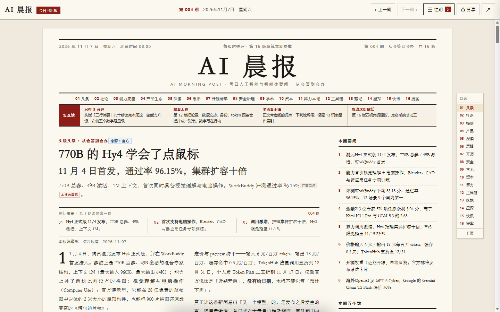
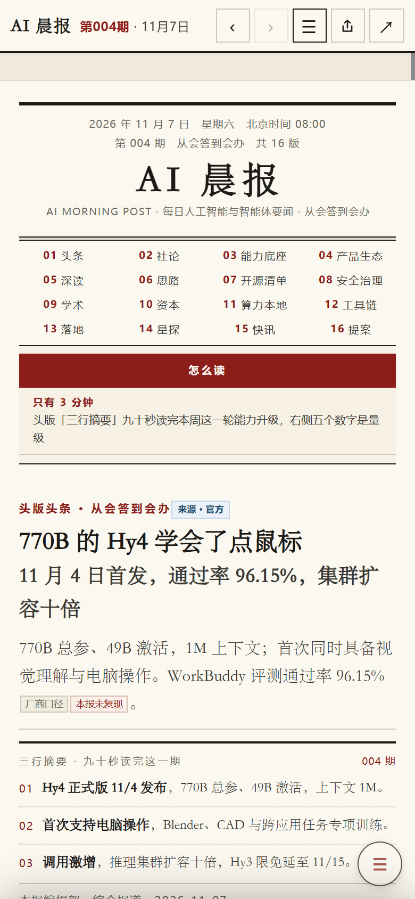

# AI 晨报

[](https://github.com/Daxiaqingxuan/ai-daily/actions/workflows/ci.yml)

**一份每天出刊的 AI 主题报纸。** 16 个版面，从选题、查证、写作到排版由脚本完成——但每个外部数字都标了出处，每一版都注明了信息来自哪里。

**不用克隆也能看：** 公开导读面 <https://daxiaqingxuan.github.io/ai-daily/> ——每期的事实卡拆成独立页面，一条断言一个网址，带证据强度与所属版面，免访问码。完整 16 版正文仍需访问码。

<p><em>AI Morning Post — a daily AI newspaper generated end-to-end by scripts, shipped as a single static HTML file.<br>
16 fixed sections; every external figure carries a source tag, and every section labels where its information came from.<br>
Nothing ships until 19 checks and 59 counter-examples pass — that gate is the actual product.</em></p>

<p align="center">
  
</p>

<p align="center">
  
</p>

报纸是纯静态 HTML，没有构建步骤。克隆下来用浏览器打开 `ai-daily/site/index.html` 就能读，断网也能读（离线快照随安装包与 Service Worker 一起带着）。线上全文入口受访问码保护，不在本仓库公开；**公开导读面在 `docs/`**（GitHub Pages 发布），只放导读、事实卡与归档索引。

## 这不是又一个 AI 摘要器

同类项目大多把 RSS 丢给模型，生成一屏卡片。这个项目多花了三份力气，都花在「读者凭什么信」上：

**一、它按报纸的规矩排，不按信息流的规矩排。**
固定 16 个版面，各版有编辑意图与篇幅纪律：01 头条、02 社论、03 能力底座、04 产品生态、05 深读、06 思路、07 开源清单、08 安全治理、09 学术、10 资本、11 算力本地、12 工具箱、13 落地、14 星探、15 快讯、16 提案。哪一版放什么、放多少，是排期决定的，不是模型临时决定的。

**二、每个数字都能追回去。**
正文里的外部数字带论据标记——厂商口径 / 公开报道 / 预印本 / 本报实测 / 本报自设。同一批数字在当期 `00-facts.json` 里各占一行，正文与卡片对不上，拼版阶段直接失败。每版版头另有一个来源标（官方 / 第三方信息网 / 本报实测 / AI 生成），「AI 生成」的版面每期不得超过 4 版——这条也由断言看着。

**三、出刊有闸门，不是「生成完就发」。**
19 项自检、每条检查项配一个反例（共 59 条）、根目录成品与站点副本逐字节对账。任何一项 FAIL 就不发布；反向验证里出现 SKIP 也算没测。

## 30 秒开始

主链路零第三方依赖，Python 3.10+ 即可，不用先 `pip install`：

```bash
git clone <this-repo> && cd <this-repo>
python ai-daily/tools/doctor.py           # 环境体检
python ai-daily/tools/selfcheck.py --pre  # 19 项自检
```

然后直接看报纸：打开 `ai-daily/site/index.html`（Windows 上 `start ai-daily/site/index.html`）。

只有图标、二维码、APK 三个辅助脚本需要 `Pillow` / `qrcode`；Android 打包另需 JDK + build-tools。缺这些工具时出报照跑，相关检查会明确跳过，不会假装通过。

## 一期报纸是怎么出刊的

```
选题与查证  →  parts/<MMDD>/00-facts.json      每个数字一行，带论据档位
写作与拼版  →  parts/<MMDD>/p01…p16.html       16 个版面，各带来源标
拼版断言    →  assemble_issue.py                A1–A16，缺版/漂移/超限直接失败
索引与副本  →  build_index.py                   生成 issues.js，单向写入 site/，顺带重生成公开面
发布前自检  →  selfcheck.py --pre               19 项
发布        →  site/ 静态托管
发布后验证  →  selfcheck.py --online            线上 sha256 与本地逐字节比对
```

每一期是一个自包含的版本：`ai-daily/parts/<MMDD>/` 存源料（版面、事实卡、信源、主线），根目录的 `AI晨报-YYYY-MM-DD.html` 是成品，`site/` 里是它的副本。`site/` 只由脚本单向写入，从不手改。

## 目录

| 路径 | 是什么 |
| --- | --- |
| `ai-daily/` | 生产线的全部：源料、成品、站点、工具、安卓壳 |
| `ai-daily/tools/` | 拼版、索引、自检、反向验证、导出、打包，全部标准库 |
| `ai-daily/parts/<MMDD>/` | 某一期的源料：16 个版面 HTML + 事实卡 + 信源 + 主线 |
| `ai-daily/site/` | 发布产物：阅读器、每期副本、离线缓存、APK |
| `learn-agent/` | 另一条线：《AI Agent 运用完全教程》与可练坏的示例工程 |
| `docs/screenshots/` | README 用图 |

## 质量是怎么保证的

这些不是口号，每条都有脚本看着：

- **事实只有一份**：入口地址只在 `site/config.js` 写一次；内容声明只写一次、由脚本派生到报尾与分享面板；`issues.js` 由脚本生成，禁手改。
- **副本必须逐字节一致**：根目录成品与 `site/` 副本按 sha256 比对，只比大小会漏掉等长替换。
- **检查器自己也要被检查**：`mutation_test.py` 给每条断言造一个反例——把成品改一个字节、把索引删一条、把线上副本做等长替换——看自检会不会红。跑之前先确认底板全绿，否则「变红」可能只是服务没起来。
- **规则不许手写**：文档里的条数、断言范围、脚本数由 `doc_sync.py` 从代码推导；对不上，自检第 14 项就红。

## 边界（它刻意不做的事）

- **不追热点做实时**。每天一期，出刊后不再改；快讯版只收当天已确认的消息。
- **不假装是新闻机构**。报尾有固定声明：内容由 AI 生成，用于产品演示，不构成事实报道。引用只做事实性转述，不转载全文。
- **不做云端定时**。出刊由会话触发，不挂服务器；换台机器也能跑，因为主链路没有第三方依赖。
- **不收集任何数据**。没有统计、没有 cookie、没有第三方脚本。

## 深入读

- [`ai-daily/AGENTS.md`](ai-daily/AGENTS.md) — 出刊流程与不变量。改代码前先读这份。
- [`项目框架与规则.md`](项目框架与规则.md) — 全局规则、目录树、断言索引。
- [`产物清单.md`](产物清单.md) — 每个产物的位置、体积、生成命令。
- [`CHANGELOG.md`](CHANGELOG.md) — 工具链与版式改了什么，按日期倒序。
- [`CONTRIBUTING.md`](CONTRIBUTING.md) — 怎么参与、提交前必须跑什么、哪些改动会被退回。
- [`SECURITY.md`](SECURITY.md) — 威胁模型、部署时你需要自己填的值。

## 许可

代码 [MIT](LICENSE)；报纸内容 [CC BY 4.0](LICENSE-CONTENT.md)（署名即可转载，第三方引用内容除外）。第三方内容与商标见 [NOTICE.md](NOTICE.md)。

---

<sub><!-- disclaimer:start -->本报内容由 AI 自动生成，用于产品演示，不构成事实报道。<!-- disclaimer:end --></sub>
